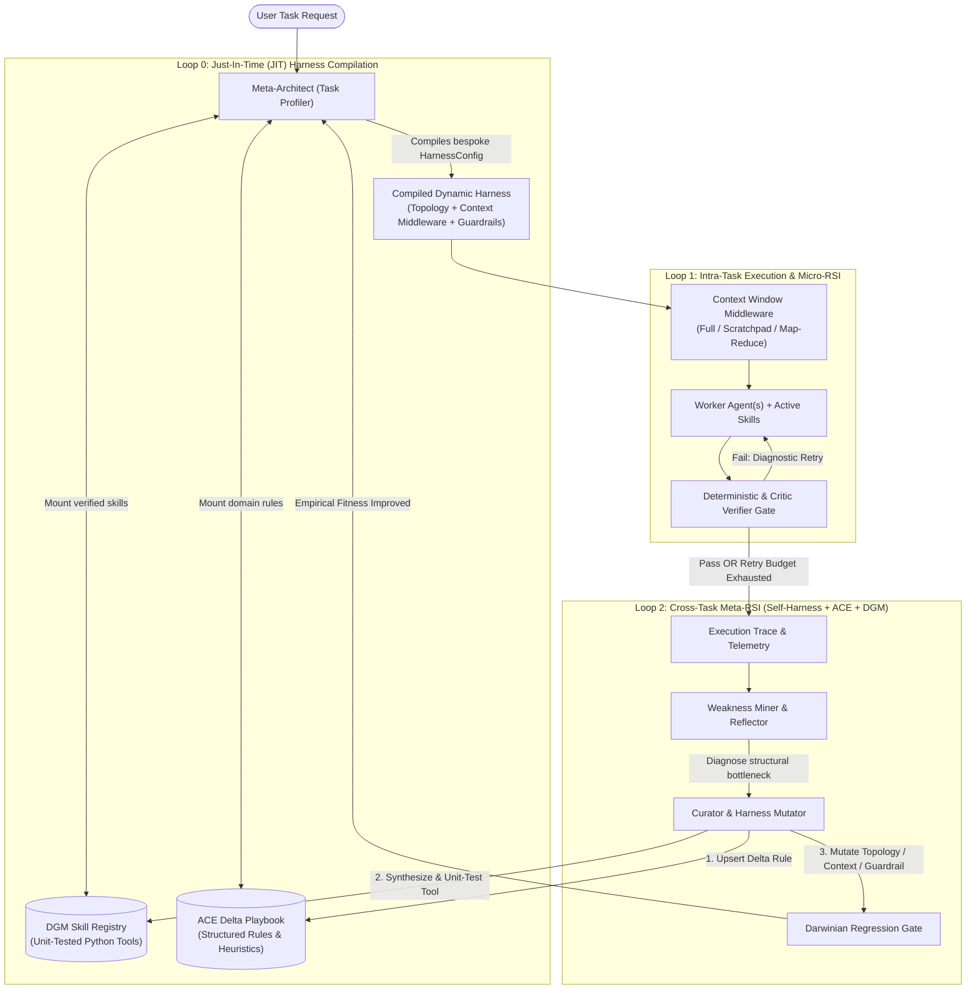

# Dynamic Agentic Harnesses & Recursive Self-Improvement (RSI)

## 1. The Core Thesis: `Effective Capability = Model × Harness(Task, Model)`

Every foundation model—whether frontier or small—has hard structural limitations baked in at pretraining/post-training time:
1. **Context Length & Attention Degradation ("Lost in the Middle"):** Even when a context window technically fits the input, attention fidelity decays with length and intermediate tool noise.
2. **Parametric Cutoff & Distribution Shift:** Frozen weights cannot natively know novel APIs, private schemas, or newly emerged domain constraints.
3. **System-1 Autoregressive Fragility:** Token-by-token generation commits without native state checkpointing, symbolic verification, or exact arithmetic execution.
4. **Model-Specific Behavioral Flaws:** Different models fail differently (e.g., skipping edge-case verification, misformatting patches, or looping on tool errors).

Historically, engineers built **static, task-specific harnesses** to compensate for a model's weaknesses on one benchmark. The breakthrough of **Recursive Self-Improvement (RSI)** at the harness layer is that **while model weights stay frozen, the harness itself is treated as mutable, self-optimizing software** that adapts *per user task* and recursively improves across tasks.

---

## 2. Latest Industry Progress (2025–2026)

Four major paradigms have defined the shift from static wrappers to self-evolving harnesses:

| Paradigm | Representative Work | Core RSI Mechanism | How It Extends a Bounded LLM |
| :--- | :--- | :--- | :--- |
| **1. Code-Space Workflow Search** | **ADAS** (*Automated Design of Agentic Systems*, Hu, Lu, Clune et al.) | Represents agent workflows as Turing-complete Python code; a **Meta-Agent** iteratively writes, evaluates, and archives better agent topologies. | Replaces rigid hand-crafted graphs with dynamically synthesized multi-agent/critic topologies. |
| **2. Trace-Driven Self-Harnessing** | **Self-Harness** (*Harnesses That Improve Themselves*, arXiv:2606.09498) | 3-stage loop: **Weakness Mining** (from execution traces) $\rightarrow$ **Harness Proposal** (minimal code/guardrail patches) $\rightarrow$ **Regression Gate**. | Automatically discovers and patches model-specific failure modes (e.g., missing verification hooks). |
| **3. Structured Playbook Evolution** | **ACE** (*Agentic Context Engineering*, arXiv:2510.04618) | Replaces monolithic prompt rewriting with a **Generator–Reflector–Curator** loop that maintains granular, versioned delta rules. | Prevents **brevity bias** and **context collapse** when accumulating long-horizon operational knowledge. |
| **4. Open-Ended Code & Tool Evolution** | **Darwin Gödel Machine (DGM)** (Sakana AI / UBC, arXiv:2505.22954) | Replaces formal Gödel mathematical proofs with **Darwinian empirical fitness** over self-authored tools and codebase mutations in sandboxes. | Enables smaller/bounded models to write and unit-test deterministic Python tools on the fly. |

---

## 3. Architecture: Building a Dynamic RSI Harness for *Any* Task

To answer your core question—*"Can we build a dynamic harness for any task that the user is asking?"*—we must decouple the architecture into **Three Nested Loops**:

### Deep Dive into the Three Loops

#### Loop 0: Just-In-Time (JIT) Task Profiling & Compilation ([`MetaArchitect`](rsi_harness/rsi_engine.py#L41-L127))
When *any* user task arrives, the harness is not fixed. `MetaArchitect` profiles the task's failure surface and compiles a [`HarnessConfig`](rsi_harness/schema.py#L59-L76):
- **Context Strategy Selection:** Chooses between `FULL_HISTORY`, `SLIDING_SCRATCHPAD`, or `HIERARCHICAL_MAP_REDUCE` to prevent context saturation before the model even sees the data.
- **Topology Selection:** Chooses `DIRECT_REACT`, `PLAN_EXECUTE_VERIFY`, `MULTI_CRITIC_DEBATE`, or `DIVIDE_AND_CONQUER`.
- **Dynamic Mounting:** Queries [`PlaybookMemory`](rsi_harness/playbook_and_skills.py#L16-L61) and [`SkillRegistry`](rsi_harness/playbook_and_skills.py#L64-L108) to mount only the high-confidence heuristics and verified tools relevant to the task's domain tags.

#### Loop 1: Runtime Execution & Context/Tool Offloading ([`DynamicHarnessExecutor`](rsi_harness/rsi_engine.py#L130-L287))
Executes the compiled harness while capturing fine-grained step telemetry into an [`ExecutionTrace`](rsi_harness/schema.py#L89-L100):
- Compresses or chunks inputs via the active [`ContextStrategy`](rsi_harness/schema.py#L19-L24).
- Offloads exact computation to verified Python tools in `SkillRegistry`.
- Enforces post-execution guardrails and deterministic verification gates.

#### Loop 2: Recursive Self-Improvement Engine ([`SelfHarnessRSIEngine`](rsi_harness/rsi_engine.py#L290-L426))
When a task fails verification (or hits a context/reasoning bottleneck), `SelfHarnessRSIEngine` runs the 3-stage RSI cycle:
1. **Weakness Mining (`mine_weakness_and_propose`):** Inspects the [`ExecutionTrace`](rsi_harness/schema.py#L89-L100) to classify whether the failure came from `CONTEXT_WINDOW_SATURATION`, `MISSING_DETERMINISTIC_SKILL`, or `WEAK_TOPOLOGY_AND_GUARDRAILS`.
2. **Tri-Modal Mutation Proposal ([`HarnessMutationProposal`](rsi_harness/schema.py#L104-L120)):**
   - **Self-Harness Patch:** Mutates the topology, context strategy, or post-execution guardrails.
   - **DGM Tool Synthesis:** Writes a new Python function + unit tests ([`SynthesizedSkill`](rsi_harness/schema.py#L44-L55)) and executes the tests in an isolated sandbox before registration.
   - **ACE Playbook Delta:** Formulates a structured `WHEN -> DO -> AVOID` [`PlaybookRule`](rsi_harness/schema.py#L28-L41) and upserts it without erasing prior rules.
3. **Darwinian Regression Gate (`validate_and_commit`):** Re-compiles the Gen-2 harness and verifies that the task now passes before committing the mutation.

---

## 4. Prototype Walkthrough & Verification

The runnable implementation is structured as follows:
- [`rsi_harness/schema.py`](rsi_harness/schema.py) — Core data models for topologies, context strategies, ACE rules, DGM skills, traces, and RSI mutation proposals.
- [`rsi_harness/playbook_and_skills.py`](rsi_harness/playbook_and_skills.py) — [`PlaybookMemory`](rsi_harness/playbook_and_skills.py#L16-L61) (ACE delta curation) and [`SkillRegistry`](rsi_harness/playbook_and_skills.py#L64-L108) (isolated Python tool compilation & unit-test verification).
- [`rsi_harness/rsi_engine.py`](rsi_harness/rsi_engine.py) — [`MetaArchitect`](rsi_harness/rsi_engine.py#L41-L127), [`DynamicHarnessExecutor`](rsi_harness/rsi_engine.py#L130-L287), and [`SelfHarnessRSIEngine`](rsi_harness/rsi_engine.py#L290-L426).
- [`run_demo.py`](run_demo.py) — End-to-end simulation across 3 distinct model failure modes:
  1. `TASK-01-LONG-CONTEXT`: Fails in Gen-1 (`3910/1200` tokens, dropping middle anomalies) $\rightarrow$ RSI mutates context strategy to `HIERARCHICAL_MAP_REDUCE` & topology to `DIVIDE_AND_CONQUER` $\rightarrow$ Gen-2 passes at `400/1200` peak tokens.
  2. `TASK-02-SYMBOLIC-MATH`: Fails in Gen-1 due to raw token arithmetic drift $\rightarrow$ RSI synthesizes and unit-tests the `exact_modular_cascade` Python skill $\rightarrow$ Gen-2 invokes the verified skill and passes.
  3. `TASK-03-ALGO-CODE`: Fails in Gen-1 on unsorted/nested intervals $\rightarrow$ RSI upgrades topology to `MULTI_CRITIC_DEBATE` and injects `guardrail:validate_empty_and_unsorted_inputs` $\rightarrow$ Gen-2 passes.
