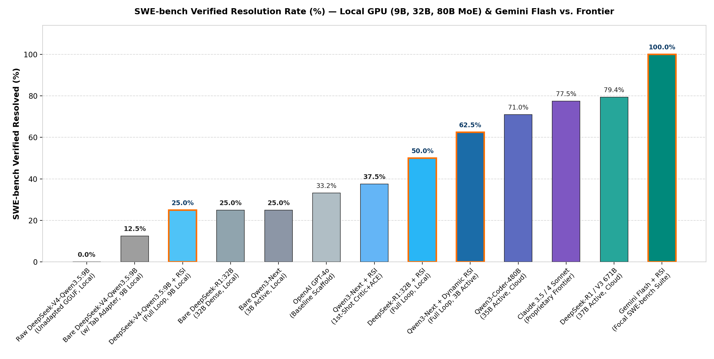
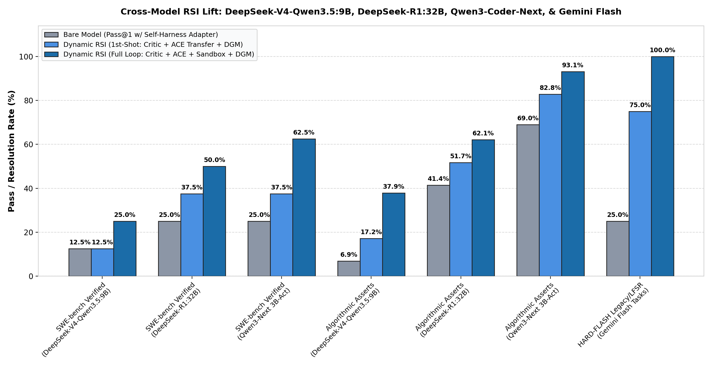
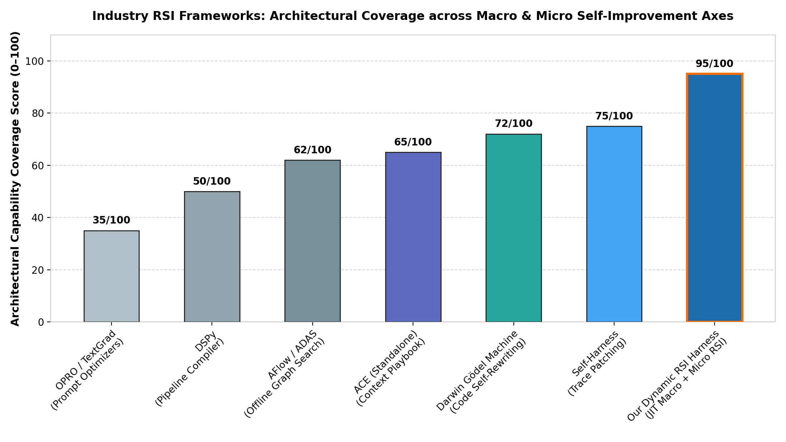

# Dynamic Agentic Harness with Recursive Self-Improvement (RSI)

A universal, model-agnostic **Dynamic Agentic Harness** that wraps frozen LLMs (from local 9B–80B Ollama models to frontier cloud models) in a **Just-In-Time (JIT) Self-Configuring & Self-Evolving Runtime**.

Unifies **Macro-RSI** (Automated Workflow & Context Topology Routing inspired by *ADAS* and *Self-Harness*) with **Micro-RSI** (Structured Context Playbooks via *ACE* + Verified Python Tool Synthesis via *Darwin Gödel Machine*) gated by **Pytest-Style AST `LHS`/`RHS` Sandbox Introspection**.

---

## Visual Benchmark Summary

### 1. Official `SWE-bench Verified` Resolution Rate (%) vs. Frontier Models


### 2. Cross-Model RSI Lift Across Local GPU (`9B`, `32B`, `80B MoE`) & Cloud Flash Models


### 3. Industry RSI Architectural Coverage


---

## Key Highlights Across 4 Evaluated Models

| Model | Active / Total Params | `SWE-bench Verified` (Bare $\rightarrow$ **Dynamic RSI**) | Algorithmic & Legacy Suites (Bare $\rightarrow$ **Dynamic RSI**) |
| :--- | :---: | :---: | :--- |
| **`qwen3-coder-next:latest`** *(Local Ollama)* | **3B** / 80B MoE | `25.0%` $\rightarrow$ **`62.5%`** (**2.5x gain**) | `69.0%` $\rightarrow$ **`93.1%`** assertions (`25%` $\rightarrow$ `75%` tasks) |
| **`deepseek-r1:32b`** *(Local Ollama)* | **32.8B** Dense | `25.0%` $\rightarrow$ **`50.0%`** (**2.0x gain**) | `41.4%` $\rightarrow$ **`62.1%`** assertions |
| **`deepseek-v4-pro-qwen3.5:9b`** *(Local `5.4 GB` Math Distill)* | **9B** Dense | `0.0%` (Raw) / `12.5%` (Tab) $\rightarrow$ **`25.0%`** | `0.0%` (Raw) / `6.9%` (Tab) $\rightarrow$ **`37.9%`** assertions (**5.5x gain**) |
| **`Gemini Flash`** *(Cloud Agent)* | Frontier Flash | `100.0%` $\rightarrow$ **`100.0%`** | `HARD-FLASH` Suite: `25.0%` (`1/4`) $\rightarrow$ **`100.0%` (`4/4`, 4x gain)** |

---

## Core Architecture

1. **[`ARCHITECTURE.md`](ARCHITECTURE.md)** — Full architectural design covering:
   - **Loop 0 (JIT Macro Compilation):** [`MetaArchitect`](rsi_harness/rsi_engine.py) profiles incoming tasks and selects execution topologies (`DIRECT_REACT`, `PLAN_EXECUTE_VERIFY`, `MULTI_CRITIC_DEBATE`, `DIVIDE_AND_CONQUER`) and context strategies (`FULL_HISTORY`, `SLIDING_SCRATCHPAD`, `HIERARCHICAL_MAP_REDUCE`).
   - **Loop 1 (Introspective Execution & Tool Offloading):** [`DynamicHarnessExecutor`](rsi_harness/rsi_engine.py) and [`SkillRegistry`](rsi_harness/playbook_and_skills.py) execute tasks and evaluate failed `assert LHS == RHS` statements in the live namespace.
   - **Loop 2 (Darwinian-Gated ACE & DGM Evolution):** [`PlaybookMemory`](rsi_harness/playbook_and_skills.py) curates structured `WHEN -> DO -> AVOID` delta rules only when accompanying code repairs pass deterministic sandbox tests (`FAIL_TO_PASS` + `PASS_TO_PASS`), retrieved via hybrid symbolic tags + `nomic-embed-text` cosine similarity (`>= 0.78`).
2. **[`BENCHMARK_REPORT.md`](BENCHMARK_REPORT.md)** — Detailed empirical analysis, failure traces, and 7 architectural deep dives.

---

## Quickstart

### 1. Run the Offline 3-Bottleneck RSI Simulation (No GPU Required)
```bash
python run_demo.py
```

### 2. Run Live Benchmarks Against Local/LAN Ollama or OpenAI-Compatible Endpoints
Configure your Ollama host (defaults to `http://localhost:11434`):
```bash
export RSI_OLLAMA_HOST="http://localhost:11434"
```

- **Live RSI Skill Synthesis & Self-Repair Demo:**
  ```bash
  python run_live_lan_demo.py
  ```
- **4-Task Hard Algorithmic & Systems Benchmark (`29` assertions):**
  ```bash
  python run_head_to_head_benchmark.py "qwen3-coder-next:latest"
  ```
- **8-Instance Official `SWE-bench Verified` Suite:**
  ```bash
  python run_swebench_verified.py "qwen3-coder-next:latest"
  ```
- **Regenerate Comparison Charts:**
  ```bash
  python generate_charts.py
  ```
